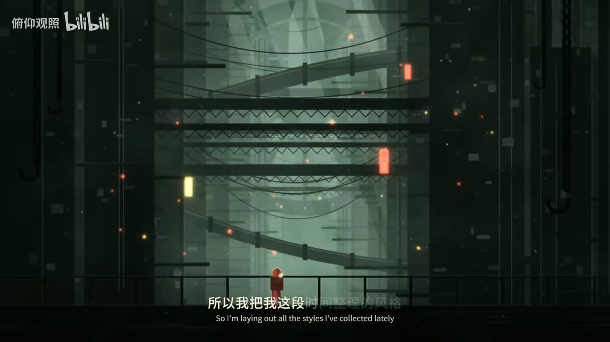
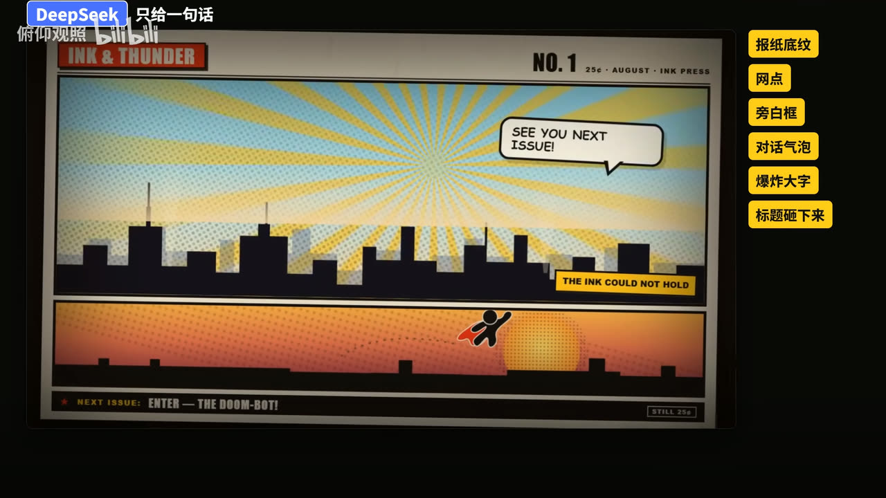
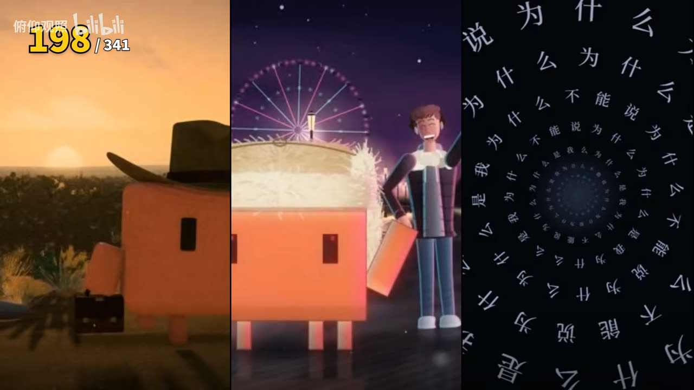
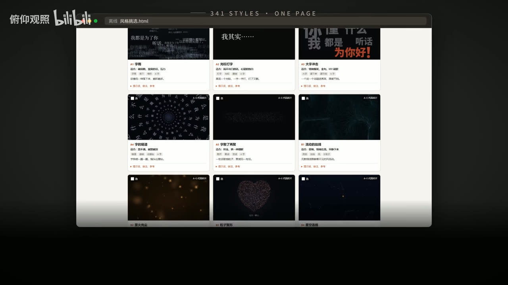
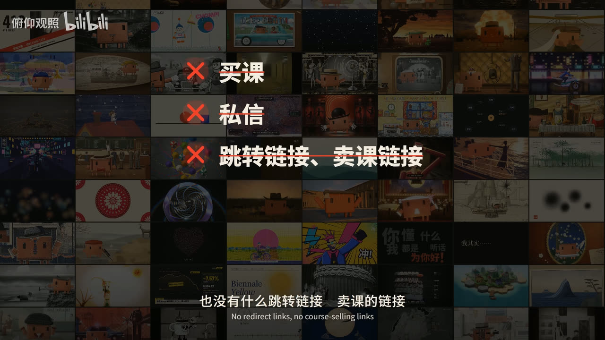

# 代码动画风格提示词库 · 341 种

> **本仓库全部资料来源于 B 站 UP 主 [俯仰观照](https://space.bilibili.com/3690990015613855)**，
> 原始视频：**【经验开源】Opus 5.5 做的代码动画，DeepSeek 也能做！341 种风格提示词，全部免费送**
> → https://www.bilibili.com/video/BV1bqx76wEUM/
>
> 本仓库只是把 up 主公开免费发放的资料原样搬运到 GitHub，方便 clone 和检索。
> **资料著作权归 up 主俯仰观照及各个开源项目原作者所有。**


---

## 这是什么

**341 种「代码动画」风格，每种一个 `.md` 提示词**，其中 193 种配一张静帧参考图。

用法很直接：把某个风格的提示词复制给 **Claude Opus 5.5** 或 **DeepSeek**（或任何能写代码的模型），让它用**原生 HTML + JavaScript + Canvas** 写出一个能在浏览器里打开的动画页面，再渲染成视频。不需要 After Effects，不需要剪辑软件——**画面是代码画出来的**。

现在用代码做动画很火，但多数人只看 Opus 5.5 的演示、自己用不了。这个库要证明的是：**DeepSeek 也能做**，而且做一小段加上测试只花了 1 块钱。

## 效果

同一份写得很细的提示词，分别交给 Opus 5.5 和 DeepSeek，成品**几乎一模一样**（两份 html + mp4 都在 [`示例/`](示例/) 里）：



只给**一句英文**提示词，DeepSeek 自己做出了一整页会动的英雄漫画（成品在 [`示例/X7_英雄漫画_只给一句话/`](示例/X7_英雄漫画_只给一句话/)）：



341 种风格横跨样片、卡通、中国风、版画、全息界面、98 部奥斯卡电影画风……一屏放不下：



## 挑风格：一个离线网页

**`风格挑选.html` 用 Chrome 或 Edge 双击就能打开，不用联网、不用起服务器。**
可以按类别筛、搜索、放大看静帧、读提示词、勾选、导出已选清单。

> ⚠️ 不要把它和 `风格提示词/` 文件夹分开——网页用**相对路径**引用那 193 张 jpg，没有内嵌 base64，分家就全图裂。



## 341 种怎么分

| 类别 | 数量 | 静帧 | 是什么 |
|---|---:|---:|---|
| [`A-G_代码样片`](风格提示词/A-G_代码样片/) | 26 | 26 | 我们自己用代码做的样片：字、粒子、线与墨、光与天气、图形与纸、讲解、质感。**每种附可直接抄的 Canvas 2D 参考实现** |
| [`M_动态风格`](风格提示词/M_动态风格/) | 40 | 1 | 整段视频怎么动、怎么剪、怎么讲（一镜到底、卡点、五幕讲解、3B1B 那种……） |
| [`K_卡通画风`](风格提示词/K_卡通画风/) | 38 | 0 | 角色和画面长什么样（扁平矢量、Q 版、皮克斯 3D、粘土、剪纸……） |
| [`Z_中国风`](风格提示词/Z_中国风/) | 15 | 1 | 水墨、工笔、剪纸、皮影、敦煌、年画、青花、京剧脸谱…… |
| [`H_现成版式`](风格提示词/H_现成版式/) | 12 | 1 | 配色 + 字体的整套搭配，全片用一套 |
| [`L_Lemo-Opuscar`](风格提示词/L_Lemo-Opuscar/) | 59 | 59 | 开源项目 Lemo-Opuscar 的风格，**每种有完整做法** |
| [`V_mg-styles-15`](风格提示词/V_mg-styles-15/) | 15 | 0 | 开源项目 mg-styles-15 的 15 种动态风格 |
| [`X_code-video`](风格提示词/X_code-video/) | 31 | 0 | 开源项目 code-video 的风格 |
| [`R_照参考学来的`](风格提示词/R_照参考学来的/) | 7 | 7 | 照参考让 AI 学着用代码画的赛博朋克 |
| [`O_奥斯卡98部`](风格提示词/O_奥斯卡98部/) | 98 | 98 | 98 部奥斯卡最佳影片，**每部一种画风**（教父的顶光、辛德勒的黑白、寄生虫的半地下……） |
| **合计** | **341** | **193** | |

提示词的**详细度分三档**，直接决定成品稳定度：

- **详细档**：A–G（带参考代码）、L / V / X（带完整做法）、O（颜色写死到十六进制）。换个模型也不容易跑偏。
- **中间档**：M、R。讲清了一整段怎么动、或一段很长的画面描述。
- **一句话档**：K、Z、H 大多只有一行，比如 Z1 水墨就是「水墨晕染，留白，竹林 / ink wash, negative space」。能用，但每次结果都不一样、也更慢。

## 怎么用

**推荐：让 AI 助手自己读这个文件夹。**

1. clone 或下载本仓库，把文件夹交给你的 **DeepSeek Harness** / Claude Code / 任何能读写文件的 agent，说：
   > 读一下这个文件夹，我要用里面的风格做代码动画。
2. 在 `风格挑选.html` 里挑好风格，点「已选清单」复制，发给它。
3. 讲清楚你想表达什么：讲什么内容、多长、横屏还是竖屏、镜头怎么走、几种风格怎么接在一起。
4. **记得说要不要配乐和音效。** 不说的话，它多半做出来是没声音的。
5. 让它输出一个能在浏览器里打开的 html，再让它渲成视频。

**只想用一个风格**：打开那一种的 `.md`，把「风格提示词」那一段复制给模型，再加上你的内容。有些提示词里有 `{{ }}`，那是要你自己填的地方。

**小提示**：提示词写得越细（颜色、时间、镜头都写死），不同模型做出来越接近。`示例/` 里两种极端都有。

## 目录结构

```
代码动画/
├── README.md                ← 本文件（GitHub 搬运时新增，非原资料）
├── 说明.md                  ← up 主原说明
├── 风格挑选.html            ← 离线挑选网页（内嵌 341 条数据）
├── _统计.json               ← 数量清单：total 341 / withStill 193 / 十个系列各多少
├── 许可与来源.md            ← 哪些是 up 主自制、哪些来自开源项目
├── .gitattributes           ← 新增：锁定换行符，保证 clone 出来字节不变
├── docs/
│   ├── images/              ← 新增：本 README 的 6 张配图（截自原视频）
│   └── agents/workspace.yaml ← 无关文件：issue 插件的工作区配置
├── 风格提示词/              ← 341 种风格，10 个系列子目录
│   └── README.md            ← 新增：341 条的完整索引
├── 示例/
│   ├── B6_光速穿梭·爆炸·重聚_同一份提示词/  ← 同一份提示词 × Opus 5.5 / DeepSeek 对比
│   └── X7_英雄漫画_只给一句话/              ← 一句英文 → 一整页漫画
└── 第三方许可/              ← Lemo-Opuscar / mg-styles-15 / code-video 三家 MIT 原文
```

## 许可与约定

**全部免费。** 不要私信索要、没有付费群、没有任何卖课链接：



up 主在视频和 [`说明.md`](说明.md) 里的原话约定：

- 你可以免费用、免费转给别人；**转的时候也请免费分享**。
- **禁止把这些内容包装成课程、付费 skills 或任何收费的东西拿去卖。**

来自开源项目的部分（L / V / X 三个系列）保留其原有 MIT 许可与署名，见 [`第三方许可/`](第三方许可/)：

| 系列 | 上游 | 版权方 |
|---|---|---|
| L Lemo-Opuscar（59） | Lemo-Opuscar | LemoLab |
| V mg-styles-15（15） | mg-styles-15 | Vincentwei1021 |
| X code-video（31） | code-video | Bae-ChangHyun |

## 两点如实说明

1. **M 系列有 8 条是空的，且这是原件本来如此、不是搬运丢失**：`M14_.md`、`M15_.md`、`M16_.md`、`M17_.md`、`M26_.md`、`M35_.md`、`M39_.md`、`M40_.md` 各 81 字节，只有模板骨架、没有名字也没有正文，所以 M 标称 40 种、实际可用 32 种。已做过溯源：up 主自己的 `风格挑选.html` 内嵌数据里这 8 条同样 `name:""` 且**根本没有 `prompt` 字段**；另一个**独立**搬运的镜像仓库 [wqb578/code-animation-341-styles](https://github.com/wqb578/code-animation-341-styles)（非 fork）里这 8 个文件的 blob SHA 与本地逐个相同。两份独立下载字节一致，排除了下载或解压损坏。证据链见 [docs/M系列8条空缺-溯源报告.md](docs/M系列8条空缺-溯源报告.md)。**本仓库按原样保留、未删改，也没有用他人内容冒充原作填进去**——若你手上有更新版的原包，欢迎开 issue 提供。
2. **`docs/agents/workspace.yaml` 与动画无关**，是搬运时用的 issue 插件自动写入的工作区配置，留着是为了让仓库和插件配合可复现。

## 下载全部源文件

到 [Releases](releases) 页面下载 **`code-animation-341-styles-v1.0.0.zip`**（或页面底部的 `Source code (zip)`），解压即用。

本仓库配置了 `.gitattributes`（`* -text`），**关闭了 git 的换行符自动转换**，所以 clone 或 zip 下载得到的每个文件与 up 主发放的原始字节**逐字节一致**（已用 md5 对全部 556 个原文件校验通过）。

---

**如果这些资料对你有用，请去原视频给 up 主一键三连支持一下：**
👉 https://www.bilibili.com/video/BV1bqx76wEUM/

up 主说：「我还会持续开源更多的干货。」
